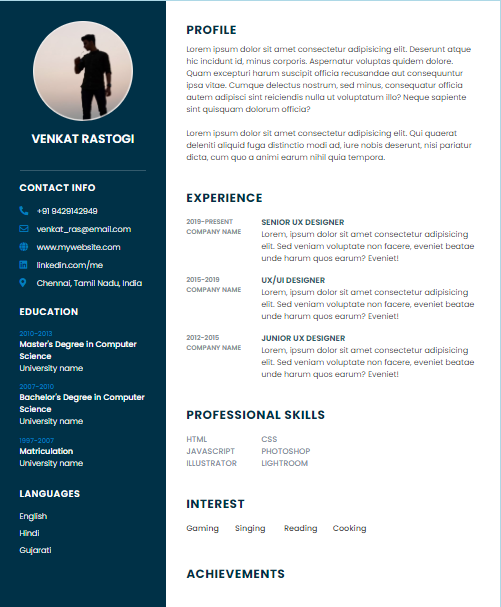
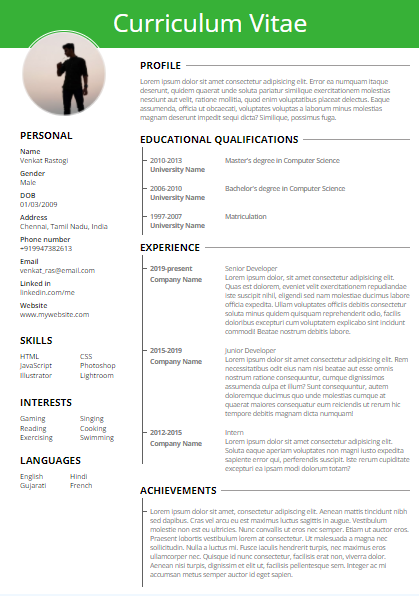
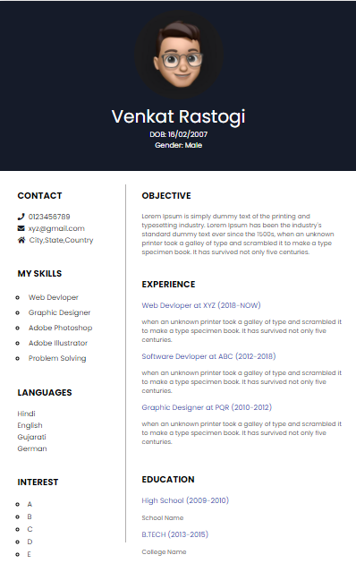

# Resume Builder

A lightweight, modern, client-side web application designed to help job seekers, students, and professionals craft, customize, and export clean, ATS-friendly resumes in minutes. Built using pure front-end web technologies, the application operates entirely in the browser—eliminating the need for account registration, server-side data processing, or subscription fees.

---

## Live Demo

Experience the live application hosted directly on GitHub Pages:

👉 **[Launch Resume Builder](https://v-jasvanth.github.io/Resume-builder/)**


## Project Preview

| Stanford Template | Harvard Template | Edinburgh Template |
| :---: | :---: | :---: |
|  |  |  |

---

## Features

- **Guided Multi-Step Workflow**: A structured 3-step form stepper (Personal Details → Experience & Qualifications → Template Selection) keeps the resume creation process organized and intuitive.
- **Three Distinct Resume Templates**:
  - **Stanford (Template 1)**: Modern two-column format with customizable sidebar accents, ideal for engineering, technical, and corporate roles.
  - **Harvard (Template 2)**: Classic, structured single/double header layout with a prominent title section and clean dividing rules, suited for academic, management, and research positions.
  - **Edinburgh (Template 3)**: Contemporary dark-header design with timeline layouts and color palette customization, perfect for creative, marketing, and design professionals.
- **Dynamic Content Sections**:
  - Personal information (name, contact details, address with offline country/state/city fallbacks, date of birth, LinkedIn, website, and custom resume title).
  - Profile photo upload with client-side file-type validation (JPG, JPEG, PNG, GIF, WEBP) and a 3 MB file size limit.
  - Dynamic educational qualifications with start and end dates.
  - Dynamic employment history with role descriptions and a "Present" checkbox toggle for current positions.
  - Dynamic skill listings, personal interests/hobbies, languages spoken, and key achievements.
- **Live Character Limits & Visual Feedback**:
  - Enforced `maxlength` thresholds on key long-text fields: Profile Summary (500 chars), Achievements (400 chars), and Work Descriptions (300 chars).
  - Progressive visual counter states: Subtle gray (< 80%), amber warning (80–94%), danger red (95–99%), and bold limit reached (100%).
- **Intelligent Field Validation**:
  - Clear, field-specific error messages (e.g., email format, phone numbers, URLs, required selections).
  - Highlighted error states with automatic smooth-scroll and focus to the first invalid field upon submission.
  - Real-time error clearing as soon as fields are corrected.
- **Automatic Draft Persistence (`localStorage`)**:
  - Auto-saves all entered data in the background as you type using a debounced persistence engine.
  - Visual status indicator in the navigation bar clearly distinguishes states: *Saving...*, *Saved just now*, *Saved recently*, *Draft restored*, and *Form cleared*.
  - Safe error handling to prevent misleading success alerts if browser storage quota is exceeded.
  - One-click **Start Fresh** modal to clear all form fields and wipe saved browser drafts.
- **Professional Print & PDF Optimization**:
  - Dedicated `@media print` CSS rules formatted for standard A4 dimensions.
  - Automatically hides form controls, navigation bars, and buttons during printing.
  - Prevents awkward page breaks inside experience and education blocks.
- **High-Resolution PNG Export**:
  - Built-in canvas export using HTML5 Canvas (`html2canvas`) generating a high-quality PNG image download.
- **Client-Side Security**:
  - Native HTML entity escaping (`escapeHTML`) prevents Cross-Site Scripting (XSS) when rendering user input into templates.

---

## Technology Stack

- **Markup & Layout**: [HTML5](https://developer.mozilla.org/en-US/docs/Web/HTML), [CSS3](https://developer.mozilla.org/en-US/docs/Web/CSS) (Flexbox, Grid, Responsive Media Queries)
- **Styling Framework**: [Bootstrap 5.1.1](https://getbootstrap.com/) & [Bootstrap Icons 1.5.0](https://icons.getbootstrap.com/), [FontAwesome](https://fontawesome.com/)
- **Client-Side Scripting**: [JavaScript (ES6)](https://developer.mozilla.org/en-US/docs/Web/JavaScript), [jQuery 3.6.0](https://jquery.com/)
- **Export Utilities**: [html2canvas 1.0.0-rc.5](https://html2canvas.hertzen.com/)
- **Storage & APIs**: Browser `localStorage` API, Web Canvas API, `FileReader` API
- **Hosting**: [GitHub Pages](https://pages.github.com/)

> **Note**: This application is strictly client-side. It does not use Node.js runtime, npm dependencies, external databases, or server-side frameworks.

---

## Project Structure

```text
Resume-builder/
├── index.html              # Homepage with template showcase, features, and contact demo
├── Form.html               # Multi-step resume builder form interface
├── faq.html                # Frequently Asked Questions accordion page
├── form.js                 # Multi-step navigation, validation, char counters, and autosave engine
├── transfer.js             # Data sanitization (XSS escaping), template rendering, export handlers
├── README.md               # Project documentation
├── .gitignore              # Git ignore rules for OS and editor artifacts
├── css/
│   ├── index.css           # Homepage styles, hero banner, and responsive layout
│   ├── form.css            # Multi-step form styles, character counter states, print media queries
│   └── faq.css             # FAQ accordion styling
├── Templates/
│   ├── template1.css       # Stanford template layout, typography, and print rules
│   ├── template1.js        # Stanford template dynamic styling scripts
│   ├── template2.css       # Harvard template layout, header borders, and print rules
│   ├── template2.js        # Harvard template dynamic styling scripts
│   └── template3.css       # Edinburgh template flexbox layout, dark theme, and print rules
└── images/                 # Template preview screenshots (T1–T4), feature graphics (R1–R3), logos
```

---

## Getting Started

Because Resume Builder is a pure client-side web application, no server installation, package managers (`npm`/`yarn`), or build steps are required.

### 1. Clone the Repository

```bash
git clone https://github.com/V-Jasvanth/Resume-builder.git
```

### 2. Open the Project

Navigate into the cloned directory:

```bash
cd Resume-builder
```

### 3. Launch in Browser

- **Direct Open**: Double-click `index.html` to open it in any modern web browser (Chrome, Edge, Firefox, Safari).
- **Using VS Code Live Server**: If using VS Code, right-click `index.html` and select **Open with Live Server**.

---

## How to Use

1. **Start Building**: From the homepage (`index.html`), click **Create Resume** or navigate directly to `Form.html`.
2. **Step 1 — Personal Details**:
   - Upload a profile picture (optional, max 3 MB; formats: JPG, PNG, GIF, WEBP).
   - Enter your name, email, phone number, address, and optional links (LinkedIn, website, custom header title).
   - Click **Next Step** to proceed (validation ensures all required fields are correctly completed).
3. **Step 2 — Experience & Background**:
   - Add your **Profile Summary** (monitored by the live 500-character counter).
   - Add one or more **Education** qualifications using the accordion adder.
   - Add one or more **Work Experience** records with descriptions and start/end dates (or toggle "Present").
   - Populate your **Skills**, **Interests/Hobbies**, **Known Languages**, and **Achievements**.
   - Click **Next Step**.
4. **Step 3 — Select & Customize Template**:
   - Choose between **Stanford**, **Harvard**, or **Edinburgh**.
   - For Stanford and Edinburgh templates, select an accent color swatch to personalize your header or sidebar palette.
   - Click **Generate CV**.
5. **Preview & Export**:
   - **Print / Save as PDF**: Click the green **Print** button to trigger your browser's print dialog. Select **Save as PDF**, set the destination layout to **Portrait**, choose **A4** paper size, and ensure **Background graphics** is checked.
   - **Download Image**: Click the blue **Download Image** button to export a high-resolution PNG snapshot via HTML5 Canvas.
   - **Make Adjustments**: Click the floating **Back to Form** button at any time to return to the editor with all your entered details preserved.

---

## Privacy and Data Storage

- **100% Client-Side Storage**: All personal information, employment records, and uploaded profile photos remain strictly on your local computer.
- **Local Browser Persistence**: The application writes drafts to the browser's native `localStorage` under the key `resumeBuilderDraft`. No data is ever transmitted to external servers, cloud databases, or third-party APIs.
- **Storage Limitations**:
  - Drafts are tied to the specific browser and device used when entering the details.
  - Using **Private / Incognito Browsing** will prevent drafts from persisting after the window is closed.
  - Manually clearing browser cache and cookies will remove saved resume drafts.
  - Clicking the **Start Fresh** button on the form will intentionally purge the local draft after confirmation.

---

## Deployment

This project is optimized for zero-configuration static web hosting. 

### Deploying to GitHub Pages
1. Push your repository to GitHub.
2. In your repository settings, go to **Pages** (under the "Code and automation" section).
3. Under **Build and deployment > Source**, select **Deploy from a branch**.
4. Choose the `main` branch and `/ (root)` folder, then click **Save**.
5. Your application will be live at `https://<username>.github.io/<repository-name>/`.
